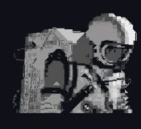

  

<h1 align="center">Eduardo Contreras</h1>
<h3 align="center">Desarrollador Frontend & Full Stack Junior</h3>

  <code>Desarrollo de interfaces web, aplicaciones móviles y arquitecturas en la nube.</code>

  Construcción de sistemas de software confiables con arquitectura limpia y soluciones escalables.

---

### Sobre Mí

**Eduardo Contreras**, TSU en Informática y estudiante de último año de Ingeniería en Informática en la Universidad Politécnica Territorial Agroindustrial del Estado Táchira (UPTAIET).

Me especializo en el desarrollo de aplicaciones web y móviles orientadas a producción con **React 19**, **Flutter (Dart)** y **Node.js**, uniendo el diseño y maquetación de interfaces con arquitecturas estructuradas de backend y bases de datos relacionales.

Actualmente implemento soluciones con **Supabase (PostgreSQL + RLS)**, **SQLite**, **Flutter** y **React**, aplicando estructuras de datos, lógica algorítmica y flujos de desarrollo asistidos por inteligencia artificial (**Cursor**, **Anthropic**).

Mi objetivo es escribir código estructurado, mantener estándares de calidad y aportar valor técnico en equipos de desarrollo en modalidad remota.

 

---

### Contacto

  
  &nbsp;&nbsp;
  
  &nbsp;&nbsp;
  

---

### Tecnologías y Herramientas

  
    
  

---

### Proyectos Destacados

| Proyecto | Descripción | Stack Tecnológico |
| :--- | :--- | :--- |
| **[Ferreira Fitness GYM](https://github.com/ejcb11/landing-page-GYM)** | Ecosistema completo para gimnasio: aplicación móvil en Flutter con carnet digital QR y seguimiento de rutinas, integrada en tiempo real con Supabase. | `Flutter` `Dart` `Supabase` `PostgreSQL` |
| **[GearStore](https://github.com/ejcb11/tienda-perifericos)** | Tienda web de periféricos y hardware desarrollada en React a partir de una librería propia de componentes UI reutilizables. | `React 19` `Vite` `React Router` `CSS3` |
| **[Clinimant](https://github.com/ejcb11/clinimant)** | Sistema Full Stack para gestión de mantenimiento biomédico, control de inventario de repuestos y órdenes de servicio técnico. | `Node.js` `Express` `SQLite3` `JWT` |

---

### Estadísticas de Actividad

  

